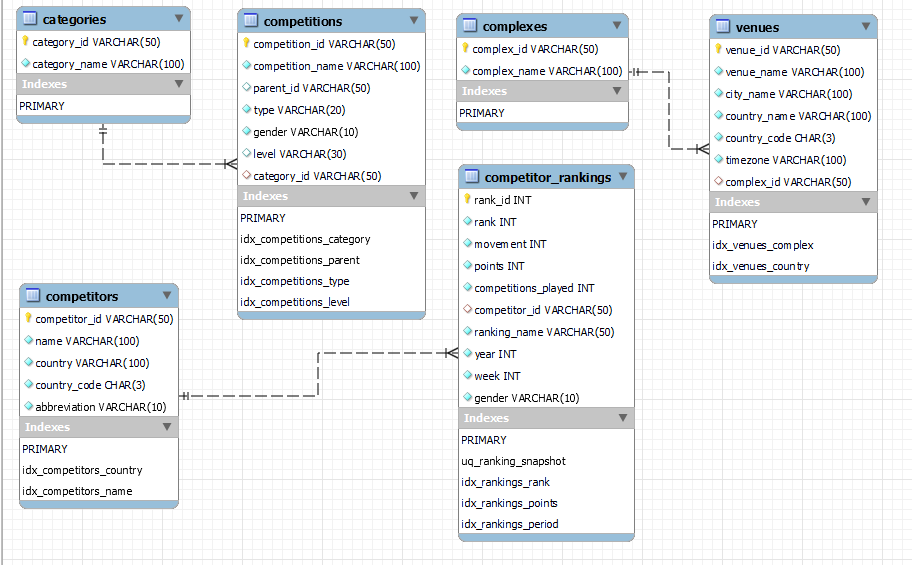

# 🎾 Game Analytics: Unlocking Tennis Data with the Sportradar API

An end-to-end data project: Sportradar Tennis API → Python (extract and transform) → MySQL (Aiven) → Streamlit dashboard.

## Features
- Extracts **competitions**, **complexes and venues**, and **doubles competitor rankings** from the Sportradar API
- Normalised MySQL schema with primary keys, foreign keys and indexes (see the ER diagram below)
- 20 analysis queries in `sql/queries.sql`
- Streamlit dashboard with top navigation: Introduction, Overview, Players, Countries, Leaderboards, Competitions, Venues, **SQL Playground** (read-only, with charts) and Insights

## Tech stack
Python · requests · pandas · SQLAlchemy · PyMySQL · MySQL (Aiven) · Streamlit · Plotly

## ER diagram


`Competitions.parent_id` is a logical self-reference (a sub-competition points to its parent). It is not enforced with a foreign key because a parent may be missing from the API data.

## Folder structure
```
Game_Analytics_Tennis/
├── api/                    # data pipeline
│   ├── config.py           # settings (reads .env locally, Secrets on Streamlit Cloud)
│   ├── sportradar_client.py# API calls with retries and rate-limit handling
│   ├── extract.py          # step 1: download raw JSON into data/raw/
│   ├── transform.py        # flatten JSON into tables
│   └── load.py             # step 3: upsert into MySQL
├── app/
│   ├── streamlit_app.py    # the dashboard
│   └── queries_loader.py   # reads sql/queries.sql for the SQL Playground
├── db/
│   ├── schema.sql          # local MySQL (Workbench) version, includes CREATE DATABASE
│   ├── schema_aiven.sql    # cloud version used by init_db.py
│   └── init_db.py          # step 2: creates the database and tables
├── sql/queries.sql         # the 20 required SQL queries
├── certs/ca.pem            # Aiven CA certificate (public)
├── docs/screenshots/       # ER diagram and query result screenshots
├── data/raw/               # downloaded JSON (not committed)
├── .streamlit/config.toml  # dark theme
├── .env.example            # template for .env
└── requirements.txt
```

## Settings files: what each one is for
| File | Purpose | Committed to GitHub? |
|---|---|---|
| `.env` | The **only** settings file the code reads. Holds your API key and database login. | No |
| `.env.local` | Optional personal copy of your local MySQL settings, handy for switching back. The code never reads it. | No |
| `.env.example` | Blank template that shows which settings exist. | Yes |
| `.streamlit/secrets.toml.example` | Template for the Secrets box on Streamlit Cloud. | Yes |

## Run it locally
```bash
python -m venv venv
venv\Scripts\activate            # Windows   (Mac/Linux: source venv/bin/activate)
pip install -r requirements.txt
copy .env.example .env           # then edit .env with your real values

python -m api.extract            # 1. download JSON from Sportradar into data/raw/
python -m db.init_db             # 2. create the database and tables
python -m api.load               # 3. load the data into MySQL
streamlit run app/streamlit_app.py
```

## Deploy
1. Create the database on **Aiven** (free MySQL), download the CA certificate to `certs/ca.pem`, then run steps 2 and 3 above with the Aiven values in `.env`.
2. Push the project to GitHub (`.env` is ignored automatically).
3. On **Streamlit Community Cloud**: New app → pick the repo → main file `app/streamlit_app.py` → Advanced settings → paste the values from `.streamlit/secrets.toml.example` into **Secrets**.

## Limitations
Trial API limits, a single ranking-week snapshot, placeholder values for missing fields, and no match-level results. See the Insights page of the app for details.

## Author
ABHIJIT SINHA