<div align="center">

# 🎾 Tennis Rankings Explorer

### Game Analytics: Unlocking Tennis Data with the Sportradar API

**From raw nested JSON to a cloud MySQL database and an interactive, dark-themed dashboard.**

[](https://tennis-rankings-explorer-stjtrxsnyclfiewespoedo.streamlit.app/)
[](https://github.com/abhi-1009/tennis-rankings-explorer)


**[🚀 Live app](https://tennis-rankings-explorer-stjtrxsnyclfiewespoedo.streamlit.app/)** ·
**[🗄️ ER diagram](docs/screenshots/ER_DIAGRAM.png)** ·
**[🧮 20 SQL queries](sql/queries.sql)** ·
**[📸 Screenshots](docs/screenshots/)**

</div>

---

## 📖 Overview

Sports data arrives as deeply nested JSON that is hard to search, compare or reuse. This project builds the whole pipeline around it:

1. **Extract** competitions, complexes and venues, and doubles competitor rankings from the Sportradar Tennis API.
2. **Transform** the nested JSON into clean, flat tables with pandas.
3. **Store** them in a normalised MySQL schema hosted on **Aiven**.
4. **Analyse** the data with 20 SQL queries.
5. **Explore** everything in a **Streamlit** dashboard deployed on Streamlit Community Cloud.

### 🎯 Business use cases
| Use case | What it answers |
|---|---|
| 🧭 **Event exploration** | How are competitions organised? Which events sit under which parent tournament? |
| 📈 **Trend analysis** | How do events split by type, gender, level and category? |
| 🎽 **Performance insights** | Which countries and players lead the doubles rankings? |
| 🧩 **Decision support** | Where are the venues and complexes, and where could organisers focus resources? |

---

## ✨ Dashboard pages

The app uses a **top navigation bar** (no sidebar), a dark court-themed design, glass cards and animated KPIs. Every chart has a one-line **takeaway** calculated from the data.

| Page | What you can do |
|---|---|
| 🏠 **Introduction** | Project story, problem statement, stakeholders and key result, **assumptions, limits and biases**, business use cases, pipeline, live dataset counts |
| 📊 **Overview** | KPI cards, top countries, competitions per category, points distribution, rank-movement split, top-5 spotlight |
| 🔎 **Players** | Search by name, filter by country, rank range and points, download CSV, open a player profile card |
| 🌍 **Countries** | Country podium, ranking charts, bubble chart, world map, points treemap |
| 🏆 **Leaderboards** | Top-ranked and highest-points lists with medals and progress bars |
| 🎾 **Competitions** | Filter by type, gender, level, category; paginated table; hierarchy viewer for parent and sub-events |
| 🏟️ **Venues** | Filter venues and complexes, world map of venues, complexes with several venues |
| 🧪 **SQL Playground** | Run your own **read-only** SQL (or any of the 20 project queries), see the table and draw instant charts |
| 💡 **Insights** | Live-calculated insights, recommendations, limitations, acknowledgements, thank-you |

<p align="center">
  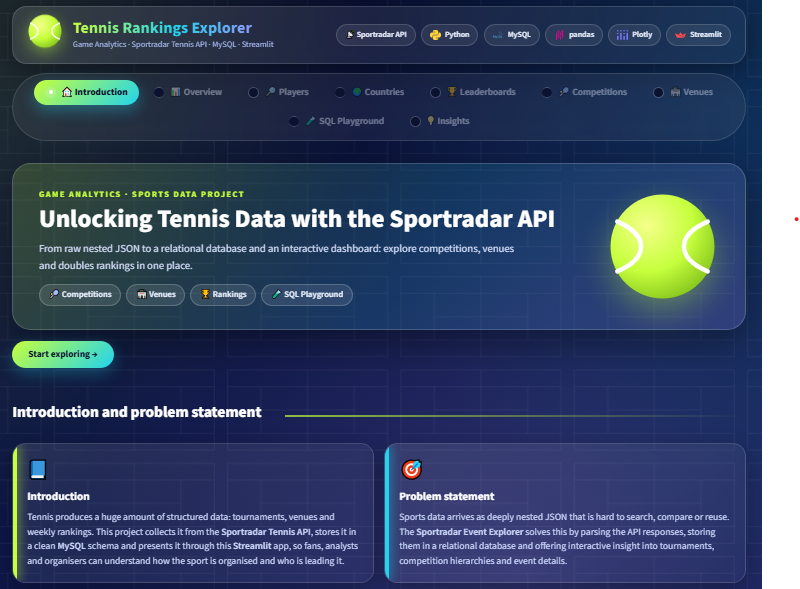
  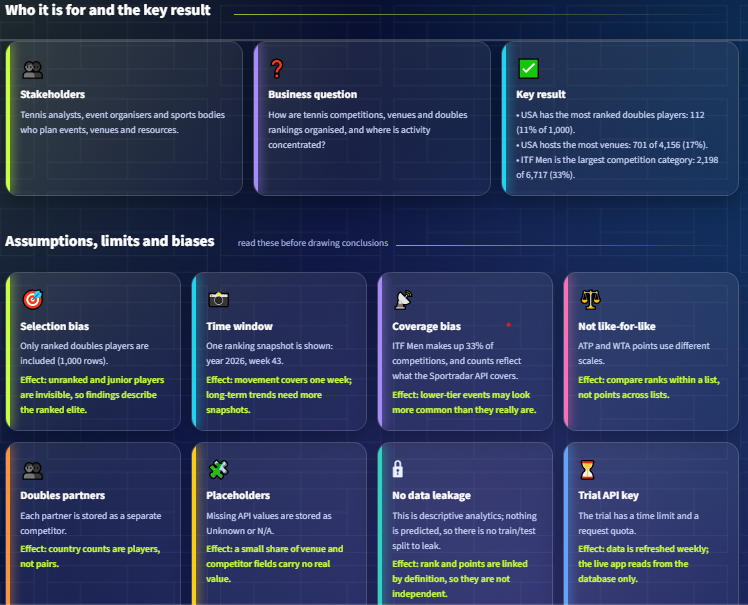
  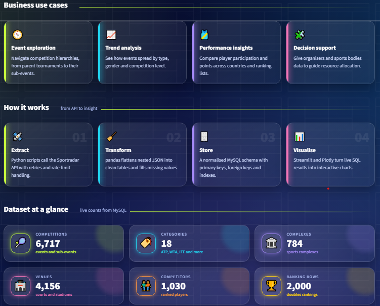
  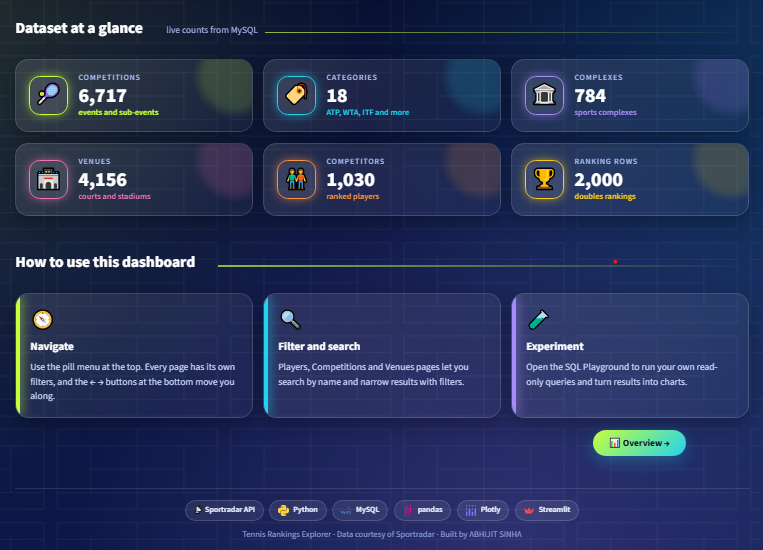
  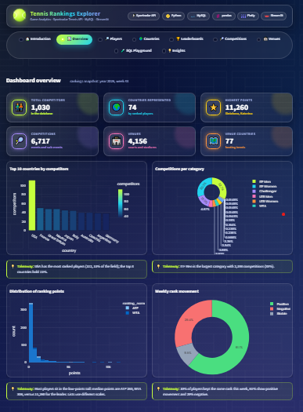
  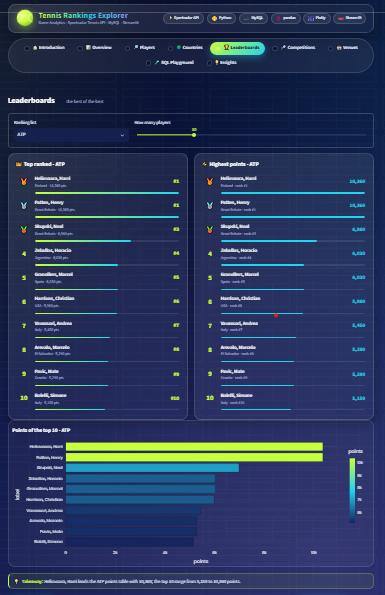
  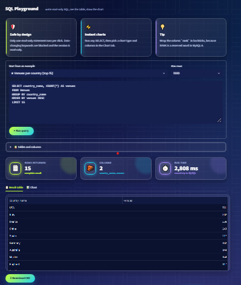
  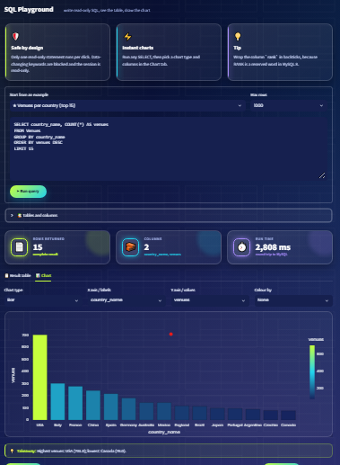
  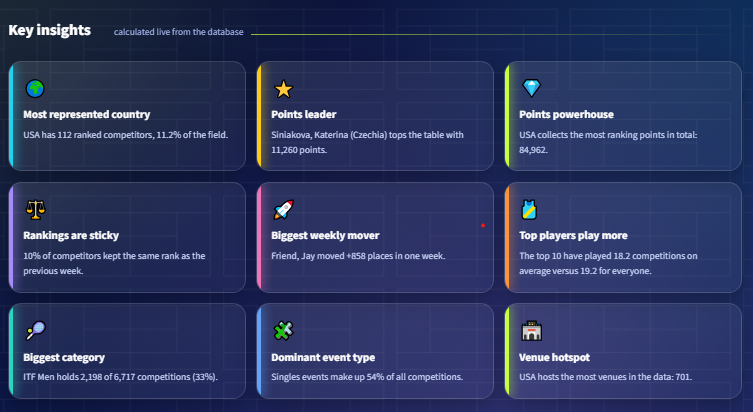
  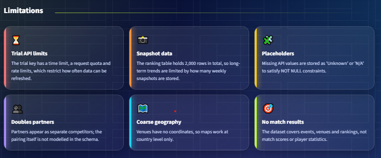
  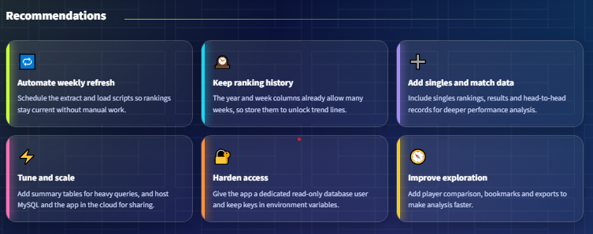
</p>

---

## 🏗️ Architecture

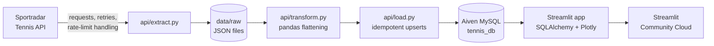

### 📦 Data at a glance
| Dataset | Rows loaded |
|---|---|
| Categories | 18 |
| Competitions | 6,722 |
| Complexes | 787 |
| Venues | 4,161 |
| Competitors | 1,049 |
| Competitor rankings | 3,000 |

---

## 🗄️ Database design


| Table | Purpose | Key design points |
|---|---|---|
| `Categories` | Competition categories such as ATP, WTA, ITF Men | PK `category_id` |
| `Competitions` | Events and sub-events | PK `competition_id`, FK to `Categories`, indexes on category, parent, type and level |
| `Complexes` | Sports complexes | PK `complex_id` |
| `Venues` | Courts and stadiums | PK `venue_id`, FK to `Complexes`, indexes on complex and country |
| `Competitors` | Ranked players | PK `competitor_id`, indexes on country and name |
| `Competitor_Rankings` | Weekly ranking rows | PK `rank_id`, FK to `Competitors`, **unique** key on competitor, list, year and week |

**Design decisions**
- 🔗 `Competitions.parent_id` is a logical self-reference, not an enforced foreign key, because a parent may be missing from the API data.
- ➕ Extra columns beyond the brief: `level` (for the level filter) and `ranking_name`, `year`, `week`, `gender` (so rankings can be filtered by week and reloads never create duplicates).
- 🔁 Loading uses `INSERT ... ON DUPLICATE KEY UPDATE`, so the pipeline can be re-run safely.
- 🧱 Missing values are stored as `Unknown` / `N/A` where the schema requires NOT NULL.

---

## 🧮 SQL analysis (20 queries)

All queries live in [`sql/queries.sql`](sql/queries.sql) and their result screenshots are in [`docs/screenshots/`](docs/screenshots/). The same queries can be run live from the **SQL Playground** page.

<details>
<summary><b>Click to see all 20 queries</b></summary>

**Part 1: Competitions**
| # | Query |
|---|---|
| 1.1 | List all competitions with their category name |
| 1.2 | Count the competitions in each category |
| 1.3 | Find all competitions of type `doubles` |
| 1.4 | Get competitions of a specific category (ITF Men) |
| 1.5 | Identify parent competitions and their sub-competitions |
| 1.6 | Distribution of competition types by category |
| 1.7 | List top-level competitions (no parent) |

**Part 2: Complexes and venues**
| # | Query |
|---|---|
| 2.1 | List venues with their complex name |
| 2.2 | Count the venues in each complex |
| 2.3 | Venue details for a specific country (Chile) |
| 2.4 | All venues and their timezones |
| 2.5 | Complexes that have more than one venue |
| 2.6 | Venues grouped by country |
| 2.7 | All venues of a specific complex (Nacional) |

**Part 3: Doubles competitor rankings**
| # | Query |
|---|---|
| 3.1 | All competitors with their rank and points |
| 3.2 | Competitors ranked in the top 5 |
| 3.3 | Competitors with no rank movement (stable rank) |
| 3.4 | Total points of competitors from a country (Croatia) |
| 3.5 | Number of competitors per country |
| 3.6 | Competitors with the highest points in the current week |

</details>

---

## 📁 Project structure

```
Game_Analytics_Tennis/
├── .streamlit/
│   ├── config.toml               # dark theme for the dashboard
│   └── secrets.toml.example      # template for Streamlit Cloud Secrets
├── api/                          # the data pipeline
│   ├── __init__.py
│   ├── config.py                 # settings: .env locally, Secrets on Streamlit Cloud, SSL for Aiven
│   ├── sportradar_client.py      # API calls with retries, backoff and rate-limit handling
│   ├── extract.py                # step 1: download raw JSON into data/raw/
│   ├── transform.py              # flatten nested JSON into tables
│   ├── load.py                   # step 3: upsert into MySQL
│   └── refresh.py                # weekly refresh: download, validate, load, verify, log
├── app/                          # the dashboard
│   ├── streamlit_app.py          # slim entry point: navigation and page routing
│   └── dashboard/                # the app code, split into small modules
│       ├── settings.py           # names, links, colours, page labels
│       ├── database.py           # engines, cached queries, read-only playground runner
│       ├── sqlguard.py           # SQL safety checks (pure Python, unit-testable)
│       ├── charts.py             # Plotly and table helpers
│       ├── components.py         # cards, KPI tiles, takeaways, pager
│       ├── theme.py              # CSS, logos, header and footer
│       ├── insights_calc.py      # numbers behind the insight cards
│       ├── queries_loader.py     # reads sql/queries.sql for the SQL Playground
│       └── views/                # one module per page
│           ├── intro.py, overview.py, players.py, countries.py, leaderboards.py
│           └── competitions.py, venues.py, playground.py, insights.py
├── certs/
│   └── ca.pem                    # Aiven CA certificate (public)
├── data/
│   └── raw/                      # downloaded JSON (git-ignored; .gitkeep keeps the folder)
├── db/
│   ├── __init__.py
│   ├── init_db.py                # step 2: creates the database and tables
│   ├── data_quality.py           # data-quality audit report
│   ├── explain_report.py         # EXPLAIN plans and timings with and without each index
│   ├── schema.sql                # local MySQL (Workbench) version
│   └── schema_aiven.sql          # cloud version used by init_db.py
├── docs/
│   ├── screenshots/              # ER diagram (.png and .mwb), Aiven counts, 20 query screenshots
│   ├── App_Screenshots/          # 11 Screenshots captured from live App 
│   ├── reports/                  # generated: data quality, EXPLAIN report, refresh log, pytest_results
│   ├── build_report              # Python file for building report
│   └── Tennis_Project_Report     # Project reported created by python file
├── sql/
│   └── queries.sql               # the 20 analysis queries
├── tests/                        # 99 pytest tests (parsers, SQL guard, API client, refresh, live DB checks)
├── .env.example                  # template for your private .env
├── .gitignore
├── pytest.ini
├── README.md
├── requirements.txt
└── requirements-dev.txt          # adds pytest for the tests and python-docx for report
```

> 🔒 **Local only, never committed:** `.env` (your real keys and passwords) and `venv/` (your Python environment).

---

## 🚀 Getting started (local)

**Prerequisites:** Python 3.10 or newer, Git, a MySQL database (local MySQL or Aiven), and a free [Sportradar](https://console.sportradar.com/signup) Tennis trial key.

```bash
# 1. Get the code
git clone https://github.com/abhi-1009/tennis-rankings-explorer.git
cd tennis-rankings-explorer

# 2. Create a virtual environment and install packages
python -m venv venv
venv\Scripts\activate            # Windows  (Mac/Linux: source venv/bin/activate)
pip install -r requirements.txt

# 3. Create your private settings file
copy .env.example .env           # Mac/Linux: cp .env.example .env
#    then open .env and fill in your real values

# 4. Run the pipeline, in this order
python -m api.extract            # download JSON from Sportradar into data/raw/
python -m db.init_db             # create the database and tables
python -m api.load               # load the data into MySQL

# 5. Launch the dashboard
streamlit run app/streamlit_app.py
```

### ⚙️ Settings (`.env`)
| Variable | Meaning | Example |
|---|---|---|
| `SPORTRADAR_API_KEY` | Your Sportradar trial key (only needed for `api.extract`) | `abc123...` |
| `DB_HOST` | Database server | `your-service.aivencloud.com` or `localhost` |
| `DB_PORT` | Database port | `12345` (Aiven) or `3306` (local) |
| `DB_USER` | Database user | `avnadmin` or `root` |
| `DB_PASSWORD` | Database password | `********` |
| `DB_NAME` | Database name | `tennis_db` |
| `DB_SSL_CA` | Path to the CA certificate. **Needed for Aiven, leave out for local MySQL** | `certs/ca.pem` |

Only the file named **`.env`** is read by the code. `.env.example` is just a blank template that is safe to share.

---

## ☁️ Deployment

1. **Database on Aiven:** create (or reuse) a MySQL service, download its CA certificate to `certs/ca.pem`, put the Aiven values in `.env`, then run `python -m db.init_db` and `python -m api.load`.
2. **Code on GitHub:** push the project. `.env` is git-ignored, so no secret is uploaded.
3. **App on Streamlit Community Cloud:**
   - New app → pick this repository → branch `main` → main file `app/streamlit_app.py`
   - Advanced settings → Python 3.12 → paste your values into **Secrets**:

```toml
DB_HOST = "your-service.aivencloud.com"
DB_PORT = "12345"
DB_USER = "avnadmin"
DB_PASSWORD = "your-password"
DB_NAME = "tennis_db"
DB_SSL_CA = "certs/ca.pem"
```

---

## 🔍 Quality, tests and monitoring

| Command | What it does | Output |
|---|---|---|
| `python -m db.data_quality` | Audits missing values and placeholders (with the reason for each treatment), integrity, duplicates, rank ties, outliers (IQR rule) and week-over-week `movement` | `docs/reports/data_quality_report.md` and `.csv` |
| `python -m db.explain_report` | Runs `EXPLAIN` and timings for the main queries, with and without each index | `docs/reports/explain_report.md` |
| `python -m api.refresh` | One-command weekly refresh: download, validate the raw data, load, verify the database, write a log line | `docs/reports/refresh_log.csv` |
| `pytest` | 73 offline tests plus 26 live-database checks (skipped automatically if the database cannot be reached) | console |

Install the test tools once with `pip install -r requirements-dev.txt`. Use `pytest -m "not db"` to skip the live checks.

**Monitoring plan.** The data is refreshed weekly with `python -m api.refresh`. Each run stops before touching the database if a download fails or a payload is empty. After loading it checks that:
- no foreign key is orphaned and no value is impossible (rank below 1, negative points),
- no table lost more than 20% of its rows compared with the previous run,
- the ranking week is not older than the one already stored,
- from the second week onward, the stored `movement` equals the real change in rank.

The exit code is `0` when healthy, `1` on failure and `2` when it loaded with warnings, so the script can be scheduled (Windows Task Scheduler or cron) and its result inspected in the log.

---

## 🛡️ Security and robustness

- 🔐 Secrets live only in `.env` locally and in Streamlit **Secrets** in the cloud. Templates in the repository contain placeholders only.
- 🧪 The **SQL Playground** is read-only by design:
  - one statement per run, starting only with `SELECT`, `WITH`, `SHOW`, `DESCRIBE` or `EXPLAIN`
  - data-changing keywords and MySQL executable comments are blocked
  - runs in a **read-only MySQL session** with a 15-second time limit and a row cap
- 🧯 Every database call is wrapped so a failure shows a friendly error card instead of crashing the app.
- ⚡ Queries are cached for 5 minutes, results are paginated, and tables are indexed on the columns the app filters by.
- 🔁 The API client retries on rate limits (HTTP 429) and server errors with exponential backoff.

---

## 🧗 Challenges and how they were solved

| Challenge | Solution |
|---|---|
| Passwords containing `@` broke the connection URL | Build the URL with `SQLAlchemy URL.create`, which escapes special characters |
| Sportradar now expects the key in a header | Send it as `x-api-key` instead of in the URL |
| Missing values in the API vs `NOT NULL` columns | Fill with `Unknown` / `N/A` during transformation |
| `rank` is a reserved word in MySQL 8 | Wrap it in backticks in all SQL |
| Aiven's free plan allows one MySQL service | Reuse the existing service with a separate `tennis_db` database |
| Cloud database needs SSL | Added `DB_SSL_CA` support and committed the public CA certificate |
| Same code on a laptop and on Streamlit Cloud | `config.py` reads `.env` first, then Streamlit Secrets |
| Re-running the loader must not duplicate data | Upserts plus a unique key on competitor, list, year and week |

---

## ✅ Evaluation checklist

| Metric from the project brief | How this project meets it |
|---|---|
| Data extraction accuracy | Retrying API client, raw JSON saved first, raw payloads validated before loading, data-quality report |
| SQL database design | 6 normalised tables, PK and FK constraints, ER diagram |
| Query efficiency | Indexes on every filter and join column, aggregation in SQL, EXPLAIN and timing report |
| Streamlit functionality | 9 pages, filters, search, pagination, charts, CSV downloads |
| Project completeness | API → JSON → MySQL → dashboard, deployed live |
| Documentation | This README, ER diagram, query file and screenshots |
| Presentation and usability | Top navigation, themed cards, live insights |
| Error handling | Retries, safe SQL playground, friendly error cards, tests for failure cases, refresh stops before changing data |
| Innovation and creativity | SQL Playground with auto charts, world maps, computed insights, no-sidebar design |

---

## ⚠️ Limitations and future work

- ⏳ The trial API key has a time limit, a request quota and rate limits.
- 📸 Only one ranking week is loaded, so long-term trends are not visible yet. The year and week columns are ready for history.
- 👥 Doubles partners appear as separate competitors; the pairing is not modelled.
- 🗺️ Venues have no coordinates, so maps work at country level.
- 🎯 No match results or player statistics yet.

**Ideas:** schedule a weekly refresh, store ranking history for trend lines, add singles rankings and match data, add player comparison, use a dedicated read-only database user for the deployed app.

---

## 🙏 Acknowledgements

- **Sportradar** for the Tennis API and the data
- **Aiven** for the free managed MySQL database
- **Streamlit** for free community hosting
- The mentors and project sessions that guided the build, and the open-source communities behind Python, pandas, SQLAlchemy, MySQL, Streamlit and Plotly

---

<div align="center">

### 👤 Author

**Abhijit Sinha**

[](https://github.com/abhi-1009)
[](https://tennis-rankings-explorer-stjtrxsnyclfiewespoedo.streamlit.app/)

<!-- Add your LinkedIn here, for example:
[](https://www.linkedin.com/in/your-profile)
-->

⭐ If you found this project useful, please star the repository.

</div>
